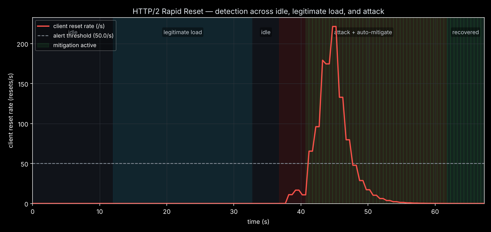

# HTTP/2 Stream-Reset DoS — Containerized Detection & Mitigation Lab

A self-contained Docker Compose lab that **reproduces, detects, and mitigates**
HTTP/2 stream-reset denial-of-service attacks against a pinned, deliberately
vulnerable server — built for an Information Security CEP on the security of
containerized environments against availability attacks.

It covers two attacks in the same class:

| | Rapid Reset | MadeYouReset |
|---|---|---|
| CVE | CVE-2023-44487 (Oct 2023) | CVE-2025-8671 (Aug 2025) |
| Who resets the stream | **client** floods `RST_STREAM` | **server** resets its own streams via crafted frames |
| Caught by client reset-rate monitoring | yes | **no** — needs the backend mismatch-ratio metric |
| Status in this lab | **fully working & verified** | research scaffold (Week-1 spike) |

> ⚠️ **Authorized lab use only.** The victim is a pinned pre-patch Tomcat that
> is *intentionally vulnerable*. Everything runs on an internal Docker bridge
> network. Never expose it to an untrusted network, and never point the attack
> client at anything other than your own lab victim (it refuses non-private
> targets by design).

---

## What it demonstrates (the money shot)

Run the attack and watch the dashboard: the client-reset rate spikes far past the
alert threshold, the detector flips to **RAPID RESET**, and when mitigation kicks
in (one click, or automatically) the attacking source is blocked at the guard —
its connection flood is cut and the victim keeps serving legitimate clients.



*Idle and a genuine legitimate load spike both keep the reset rate at ~0; only the
attack crosses the threshold, and auto-mitigation knocks it back down. This plot
is produced by `scripts/evaluate.py` and is the project's central evaluation
artifact — it answers "does the detector just trip on any load spike?" with a no.*

---

## Architecture

```
 attacker ─┐                         ┌── victim-exporter ──┐
 (lab load)│                         │ (tails HTTP/2 debug  │
           ▼                         │  log -> metrics)     │
        ┌──────┐   h2c (TCP)   ┌─────┴─────┐                │  metrics
        │ guard│──────────────▶│  victim   │                ▼
        │ (L4  │               │ (pinned,  │          ┌───────────┐
        │proxy,│◀── block ─────│ vulnerable│          │ detector  │
        │block-│   source      │  Tomcat)  │          │ reset-rate│
        │list) │               └───────────┘          │ + mismatch│
        └──┬───┘                                       │  + EWMA   │
           │ enforcement                               └─────┬─────┘
           └───────────────── block/unblock ◀───────────────┘
                                                        │ state
                                                        ▼
                                                  ┌───────────┐
                                                  │ dashboard │
                                                  └───────────┘
```

| Service | What it does |
|---|---|
| **victim** | Pinned **Tomcat 10.1.43** (pre-patch, vulnerable), HTTP/2 over cleartext (h2c), `org.apache.coyote.http2` FINE logging on. A `/?ms=N` endpoint simulates backend work. |
| **victim-exporter** | Tails the Tomcat debug log and exposes Prometheus metrics: client/server reset counts (de-duped per connection+stream), request counts, and the approximate `mismatch_ratio`. Stdlib only. |
| **guard** | L4 (TCP) proxy in front of the victim and the **mitigation enforcement point**. Holds a source blocklist; on block it terminates the source's live connections *and* drops its reconnects. |
| **detector** | Scrapes the exporter + guard every second, computes the EWMA-smoothed **client reset rate** (Rapid Reset) and **mismatch ratio** (MadeYouReset), raises an alert, and drives auto/manual mitigation. Exposes a JSON API. |
| **dashboard** | Live web UI (`:8088`): alert banner, charts, and a **Mitigate** button + auto-mitigate toggle. |
| **attacker** | Lab traffic generator: `rapid-reset`, `legit`, `idle`, and a `madeyoureset` research scaffold. Refuses non-lab targets. |
| **prometheus / cadvisor** | Optional (`--profile metrics`) time-series history + container CPU/mem. |

---

## Quick start

Requires Docker + Docker Compose.

```bash
# 1. build & start the core stack
docker compose up --build -d

# 2. open the dashboard
open http://localhost:8088        # (or just browse to it)

# 3. in another terminal, run a scenario
./scripts/scenario.sh legit          # legitimate load — detector stays calm
./scripts/scenario.sh rapid-reset    # the attack — watch the alert fire
```

When the alert fires, click **Mitigate now** on the dashboard (or flip on
**Auto-mitigate**) and watch the reset rate collapse while the victim keeps
serving.

### One-shot evaluation (produces the plot)

```bash
pip install -r scripts/requirements.txt   # matplotlib, on the host
python3 scripts/evaluate.py               # runs idle -> legit -> attack, writes docs/evaluation.png
```

### Optional metrics stack

```bash
docker compose --profile metrics up -d    # Prometheus :9090, cAdvisor :8081
```

---

## Ports

| Port | Service |
|---|---|
| 8088 | dashboard |
| 8080 | guard (victim entrypoint; h2c) |
| 9130 | detector API/metrics |
| 9090 | Prometheus (metrics profile) |
| 8081 | cAdvisor (metrics profile) |

---

## Tuning the detector

Thresholds are environment variables on the `detector` service in
`docker-compose.yml`:

| Var | Default | Meaning |
|---|---|---|
| `RAPID_RESET_RATE_THRESHOLD` | 50 | client resets/s that trips the Rapid Reset alert |
| `MISMATCH_RATIO_THRESHOLD` | 3.0 | inflight/open_streams that trips the MadeYouReset alert |
| `EWMA_ALPHA` | 0.4 | smoothing (higher = faster, noisier) |
| `BLOCK_COOLDOWN` | 60 | seconds a blocked source stays blocked |
| `AUTO_MITIGATE` | false | block automatically on alert |

The thresholds are meant to be **chosen from the evaluation data**, not assumed —
see `docs/EVALUATION.md`.

---

## Docs

- `docs/EVALUATION.md` — the three-scenario method, the plot, and how to pick a threshold.
- `docs/MADEYOURESET.md` — the Week-1 research spike: how to develop the MadeYouReset path and the mismatch-ratio detector.
- `docs/SAFETY.md` — scope, safeguards, and responsible-use notes.

## Status

- **Rapid Reset (CVE-2023-44487): complete and verified** — reproduce → detect → mitigate, with the evaluation plot.
- **MadeYouReset (CVE-2025-8671): scaffolded** — victim is vulnerable, server-reset signal and mismatch-ratio pipeline are wired; the crafted-frame trigger is the open research task (per the proposal's Section 8 plan).
