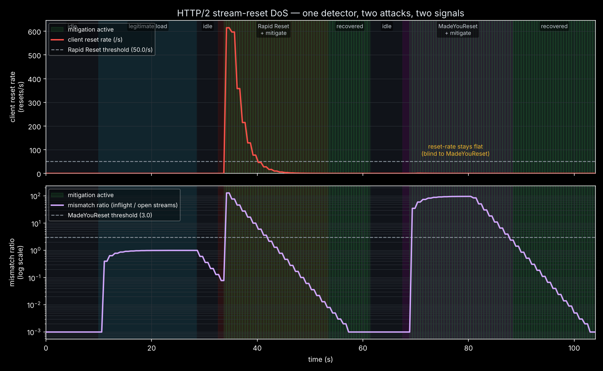

# Evaluation

The detector's thresholds are **derived from data, not assumed**. The evaluation
runs the same victim under three scenarios and plots the detection signal for
each, so the threshold is chosen where the attack curve cleanly separates from
the benign curves.

Run it (stack must be up):

```bash
pip install -r scripts/requirements.txt
python3 scripts/evaluate.py      # writes docs/evaluation.csv and docs/evaluation.png
```

## Scenarios

The run exercises **both** attacks against the same victim and detector:

1. **Idle baseline** — victim under no load. Establishes the resting signals.
2. **Legitimate load spike** — 6 honest HTTP/2 clients hammering the work
   endpoint. This is the control: a real traffic burst that must *not* trip
   either detector.
3. **Rapid Reset attack** — 8 connections flooding `HEADERS`+`RST_STREAM`, with
   **auto-mitigation enabled**.
4. **MadeYouReset attack** — 3 connections of crafted `WINDOW_UPDATE` (inc 0)
   frames that make the server reset its own streams, with **auto-mitigation
   enabled**.

## Result (representative run)

| Scenario | Client reset rate | Mismatch ratio | Alert |
|---|---|---|---|
| Idle baseline | 0 /s | ~0 | NORMAL |
| Legitimate load spike | 0 /s | ~1 (below 3.0) | NORMAL |
| Rapid Reset attack | ~600 /s | elevated | **RAPID_RESET** |
| MadeYouReset attack | **0 /s** | >100 | **MADEYOURESET** |
| After auto-mitigation | 0 /s | drains to ~0 | NORMAL |



## Reading the two-panel plot

- **Top panel — client reset rate (Rapid Reset signal).** Flat during idle and
  legitimate load, spikes an order of magnitude past the `50/s` threshold during
  Rapid Reset, and — the key point — stays **flat at zero during MadeYouReset**.
  Reset-rate monitoring is blind to the server-side attack.
- **Bottom panel — mismatch ratio (MadeYouReset signal, log scale).** Sits near
  `1` under legitimate load (safely below the `3.0` threshold), and crosses it
  for **both** attacks — catching the MadeYouReset case the top panel misses.
- The green wash marks where mitigation was active; after the attacking source
  is blocked at the guard, each signal collapses back toward baseline.

## Choosing the threshold

Any value in the wide gap between the benign ceiling (~0/s here) and the attack
floor (tens to hundreds /s) works. `50/s` is used as a safe default with large
margin on both sides. On a noisier real workload you would set it a few × above
the legitimate ceiling observed in scenario 2.

The same logic picks the **mismatch-ratio** threshold: legitimate load holds the
ratio near `1`, while MadeYouReset drives it past `100`, so `3.0` sits in a wide
gap with a comfortable margin above the benign ceiling.

## Honest limitations

- The reset signal comes from parsing Tomcat's debug log, which captures the
  large majority (not 100%) of individual resets — fine for a **rate-based**
  detector with this much margin, but not an exact per-stream audit.
- There is a short measurement lag (log flush + tail + EWMA) between enforcement
  and the measured rate returning to zero; enforcement at the guard is immediate
  (see `guard_blocked_connections_total`).
